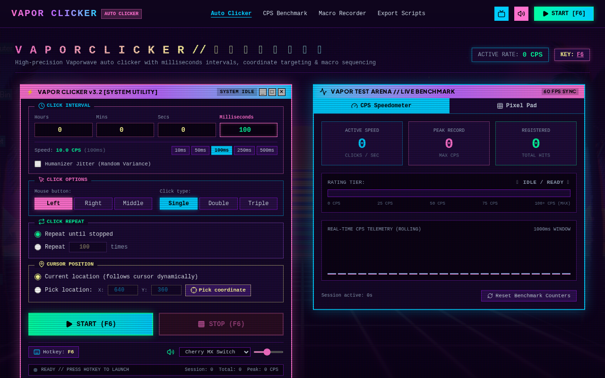

# Vapor Clicker

A Vaporwave-styled auto-clicking utility and performance benchmark application.



## Features

- **Click Interval Controls**:
  - Milliseconds precision (down to 1ms).
  - Seconds, Minutes, and Hours inputs.
  - Quick interval presets (10ms, 50ms, 100ms, 250ms, 500ms).
  - **Humanizer Jitter**: Optional randomized interval variance ($\pm\text{ms}$) to simulate natural human variation.

- **Click Options**:
  - Mouse Buttons: **Left**, **Right**, or **Middle**.
  - Click Types: **Single**, **Double**, or **Triple** clicks.

- **Click Repeat Modes**:
  - Repeat until stopped (infinite mode).
  - Repeat exact count with live countdown progress.

- **Targeting & Coordinates**:
  - **Current Location**: Follows mouse cursor in real time.
  - **Pick Location**: Set fixed `(X, Y)` coordinates with an interactive reticle picker.
  - Visual target radar crosshairs and ripple animations.

- **Global Hotkeys**:
  - Default `F6` Start/Stop toggle.
  - Custom hotkey remapping (Space, F8, X, etc.) and `ESC` emergency stop.

- **Multi-Target Macro Recorder**:
  - Live click and waypoint sequence recorder.
  - Custom delays, button types, and visual waypoint path tracing.
  - Export and import macro profiles via JSON.

- **CPS Benchmark & Sandbox**:
  - Live speedometer gauge with peak CPS and rolling telemetry graph.
  - Rating tier evaluations (Casual, Pro Gamer, Turbo, Overclock, Lightspeed Max).
  - Interactive pixel canvas pad.

- **Desktop Script Exporters**:
  - 1-click export for **AutoHotkey (.ahk)**, **Python (`pyautogui`)**, **Browser Bookmarklet**, and **PowerShell** to run the clicker globally outside the browser.

- **Vaporwave Aesthetics & Audio**:
  - CRT scanlines toggle and retro Windows 95 3D bevels.
  - Synthesized Web Audio API sound effects (Cherry MX mechanical switch, 8-bit arcade beep, synth pop, vapor chime, or mute).

## Getting Started

### Windows Download (.exe)
1. Go to the **[Latest GitHub Release](https://github.com/xpatfussy69x/vaporclick/releases/tag/v1.0.0)**.
2. Download **`VaporClicker-Setup.exe`**.
3. Double-click **`VaporClicker-Setup.exe`** to install and immediately run Vapor Clicker on your PC (this bundles all necessary dependencies and DLLs automatically).

### Web / Development Setup
```bash
# Clone the repository
git clone https://github.com/xpatfussy69x/vaporclick.git
cd vaporclick

# Install dependencies
npm install

# Start development server
npm run dev

# Build for production
npm run build
```

## License
MIT
